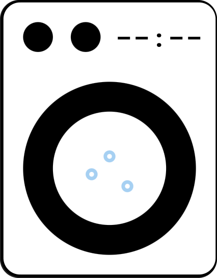
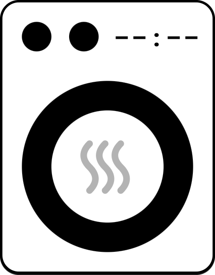

# Washer Dryer Card

A custom Lovelace card for Home Assistant to display information
about a washing machine or tumble dryer.

The card supports both washer and dryer variants and includes a
visual configuration editor.

 

## Features

- Supports washing machines and tumble dryers.
- Select the card type: Washer or Dryer.
- Configure entities using Home Assistant's visual card editor.
- Select the job state entity.
- Select the estimated completion time entity.
- Configure the card through the graphical editor or YAML.

## Installation

### HACS

1. Open HACS in Home Assistant.
2. Open the menu in the top-right corner.
3. Select **Custom repositories**.
4. Enter the URL of this GitHub repository.
5. Select **Dashboard** as the repository category.
6. Click **Add**.
7. Find Washer Dryer Card in HACS and download it.

After installation, refresh your Home Assistant browser.

If the resource has not been registered automatically, add it under
**Settings → Dashboards → Resources**:

- URL: `/hacsfiles/washer-dryer-card/washer-dryer-card.js`
- Resource type: `JavaScript Module`

## Configuration

### Visual editor

Add a new card to your dashboard and select Washer Dryer Card.

The visual editor lets you configure:

| Option | Description |
| --- | --- |
| Type | Select Washer or Dryer |
| Job state entity | Entity reporting the appliance's job state |
| Completion time entity | Entity reporting the estimated completion time |

### YAML configuration

Example for a washing machine:

```yaml
type: custom:washer-dryer-card
variant: washer
job_state_entity: sensor.washer_job_state
completion_time_entity: sensor.washer_completion_time
```

Example for a tumble dryer:

```yaml
type: custom:washer-dryer-card
variant: dryer
job_state_entity: sensor.dryer_job_state
completion_time_entity: sensor.dryer_completion_time
```

Replace the example entity IDs with the entities provided by your
own washing machine or tumble dryer integration.

## Requirements

- Home Assistant
- A washing machine or tumble dryer integration that provides
  suitable job state and completion time entities

## Troubleshooting

### The card does not appear

Check that the JavaScript resource is loaded and that the resource
URL points to the installed card file.

Try refreshing the browser after installation or after updating
the card.

### The card does not show the expected information

Check that the configured entity IDs exist in Home Assistant and
report the expected information.

## Contributing

Bug reports, suggestions and pull requests are welcome.

## License

See the LICENSE file in this repository.

## ☕ Support

Washer-Dryer-Card is free and developed in my spare time.
If you like this card, please support my Work!
<br>
<a href="https://www.buymeacoffee.com/skorpi0n" target="_blank"></a>